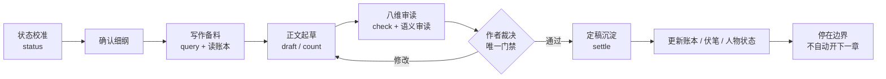

# WorkBuddy Webnovel Writer · 长篇网文写作工作台

> 一套给 [WorkBuddy AI](https://www.workbuddy.cn/) 用的原生技能（Skill），把长篇小说创作变成**可暂停、可恢复、可追溯**的本地文件工程。
>
> 写到几百章，依然记得住设定、接得住伏笔、守得住大纲。

[English summary](#english-summary) · [快速开始](#快速开始) · [工作流](#章节闭环) · [设计取舍](#与-dsh-scriptor-的关系)

---

## 为什么需要它

用 AI 写单章，效果往往不错；写长篇连载，几乎一定会崩：

| 症状 | 根因 |
| --- | --- |
| 人物性格、口癖、动机逐渐走样 | 设定只存在于早期对话里，上下文一断就没了 |
| 战力、时间线、地点前后打架 | 没有「发生过什么」的登记处 |
| 伏笔埋了不收、收了没人记得 | 缺少带章号的线索台账 |
| 断更几天回来，不知道写到哪 | 进度靠会话记忆，而不是磁盘上的文件 |
| 每章都像 AI 写的 | 没有独立的审读与去 AI 味环节 |

这个技能不提供「一键生成百万字」的幻觉。它提供的是一套**纪律**：把必须记住的东西写成文件，把「怎么写」和「写了什么」分开——文笔可以放开发挥，但发生过的事实必须登记、过审、存档。

## 特性

- **文件化书仓**：全部产物是普通 UTF-8 Markdown / JSON / TXT，能用 Git 管理、任何编辑器打开、跨工具迁移，不绑定某个平台。
- **三区分治**：真源区（契约 / 世界书 / 大纲 / 账本）、草稿区（多稿试错）、定稿区（只读）。改已定稿设定走 retcon 留痕，不偷偷覆盖历史。
- **断更无损恢复**：进度完全从磁盘文件推导（`novel.py status`），换会话、换电脑、停更几个月，回来说一句"继续"就能对准位置。
- **七步章节闭环**：状态校准 → 确认细纲 → 写作备料 → 起草 → 八维审读 → 作者裁决 → 定稿沉淀。
- **八维审读 + 确定性检查**：章节结构、人物与关系、情节与因果、信息披露、线索与伏笔、节奏与张力、读者承诺、文风与表达；字数、篇幅、占位符、章号连续性由脚本计算，不靠模型估。
- **作者掌舵**：AI 不代作者批准定稿、不伪造审查结论、不自动推进下一章。
- **零依赖**：脚本只用 Python 3.9+ 标准库，Windows / macOS / Linux 通用，不需要 API Key、向量库、Node 或数据库。

## 快速开始

### 1. 安装技能

**WorkBuddy（推荐）**：把整个仓库放到用户级技能目录：

```bash
# Windows (Git Bash / PowerShell)
git clone https://github.com/LiQingfeng111/workbuddy-webnovel-writer.git \
  "$HOME/.workbuddy-ai/skills/webnovel-writer"

# macOS / Linux
git clone https://github.com/LiQingfeng111/workbuddy-webnovel-writer.git \
  ~/.workbuddy-ai/skills/webnovel-writer
```

项目级使用则放到 `<项目>/.workbuddy-ai/skills/webnovel-writer/`。重启会话后，直接说「帮我开一本新书」「写第 12 章」「查一下伏笔」即可触发。

**独立 CLI**：不装 WorkBuddy 也能用脚本管理书仓：

```bash
python -X utf8 scripts/novel.py init --root ./我的书 --title "长夜将明" --genre 都市异能 --platform 起点
python -X utf8 scripts/novel.py status --root ./我的书
```

### 2. 开一本新书

在 WorkBuddy 里说：

> 帮我开一本新书，都市异能，起点向，单章 2000 字左右。

技能会问清书名、题材、平台、篇幅、人称，生成书仓，然后陪你逐项确认 `00-契约.md`、世界书与卷纲。

### 3. 写第一章

> 写第 1 章。

技能先 `status` 校准，再备料、起草、审读、呈报，**等你确认后**才定稿入档。之后：

```
继续第 2 章          # 从文件恢复进度，不需要重新讲设定
查一下「青铜钥匙」    # 全文检索，附文件名与行号
审稿第 3 章           # 八维审读 + 确定性检查
导出第一卷            # 只导出定稿，不含草稿
```

## 章节闭环



八步之外还有两条贯穿始终的线：**字数等确定性数据一律以脚本为准**，**任何写入以文件为唯一事实源**。

## 书仓结构

```
<书仓根>/
├── .novel/
│   ├── config.json        # 书名、题材、平台、篇幅约定
│   ├── state.json         # 派生缓存，可删除并由 status 重建
│   └── 变更记录.md         # retcon / 设定修订留痕
├── 00-契约.md             # 真源：定调、读者承诺、禁区、篇幅
├── 01-世界书/             # 真源：人物 / 势力与地点 / 规则 / 时间线
├── 02-大纲/               # 真源：总纲 + 卷NN.md（卷纲与逐章细纲）
├── 03-正文/               # 定稿区：第NNN章_章名.md（只读）
├── 04-草稿区/             # 草稿区：第NNN章/稿N.md、审读报告.md
├── 05-账本/               # 真源：事实账本 / 伏笔台账 / 人物状态 / 本书记忆
└── 06-导出/               # 派生：定稿合集
```

字段与命名规则见 [`references/08-书仓格式.md`](references/08-书仓格式.md)。

## 命令速查

所有命令：`python -X utf8 scripts/novel.py <命令> --root <书仓根> [选项]`

| 命令 | 作用 |
| --- | --- |
| `init` | 从模板生成书仓，不覆盖已有文件 |
| `status [--json]` | 从实际文件推导进度、待办、伏笔与字数 |
| `draft --chapter N --title 章名` | 创建该章草稿骨架 |
| `count --file <路径>` | 汉字数 / 字符数 / 非空白字符数 |
| `check --chapter N` | 篇幅、章号、占位符、frontmatter、伏笔登记 |
| `query --term 关键词` | 全文检索，附文件名与行号 |
| `settle --chapter N --title 章名 --confirm "作者确认原话"` | 作者确认后原子入档（`--confirm` 必填，写入留痕） |
| `retcon --note 说明` | 设定修订留痕 |
| `export [--volume N] [--format txt\|md]` | 导出定稿合集 |
| `rebuild` | 从文件重建 `state.json` |

`tests/test_novel.py` 覆盖汉字统计、篇幅判定、章号解析、状态推导与导出：

```bash
python -m unittest discover -s tests -v
```

## 仓库内容

```
SKILL.md                    技能入口（WorkBuddy 读取）
README.md                   本文件
references/                 八份按需加载的工作流参考
  01-立项与契约.md
  02-世界书与大纲.md
  03-写章闭环.md
  04-八维审读.md
  05-事实沉淀与断更恢复.md
  06-去AI味与文风.md
  07-题材速查.md
  08-书仓格式.md
scripts/novel.py            确定性工具（仅标准库）
assets/book-template/       书仓模板
examples/demo-book/         最小示例书仓
tests/                      单元测试
```

参考文档按「渐进披露」组织：技能被触发时只加载 `SKILL.md`，需要哪个环节再读对应参考，避免把整本手册塞进上下文。

## 与 DSH Scriptor 的关系

这个项目的灵感来自 [lingfengQAQ/webnovel-writer](https://github.com/lingfengQAQ/webnovel-writer)（DSH Scriptor，`@linfengqaqtat/dsh-scriptor`）与 [oh-story](https://github.com/zenstory-ai/oh-story-claudecode) 等社区作品——特别是「文件即真源」「断更从文件恢复」「作者裁决是唯一门禁」「八维审读」「草稿/真源/定稿三区分治」这些设计思想，非常值得学习，在此致谢。

**本项目是独立实现**：没有复制上述项目的代码、脚本文档或提示词文本，没有使用其运行时、API 或数据格式，也不兼容其书仓。它面向 WorkBuddy 的技能机制重新设计，目标是零依赖、纯文件、可单独使用。上游项目采用 GPL-3.0-only，本项目采用 MIT，两者是互不隶属的不同作品。若需要 DSH 桌面的书稿编辑器、子代理编排与可视化图谱，请直接使用上游正式版。

## 设计取舍

| 取舍 | 理由 |
| --- | --- |
| 不内置向量检索 / RAG | 长篇一致性靠结构化的设定集、章摘要与伏笔台账 + 全文检索已足够；少一个服务就少一处故障 |
| 不实现子代理与可视化面板 | 那是宿主能力；本技能保持纯文件与纯 CLI，换工具也能用 |
| 汉字数按正文（含章标题、排除 frontmatter 与注释）统计 | 与中文网文平台的稿酬/更新口径接近，且可确定性复算 |
| 定稿只读 + retcon 留痕 | 长篇最怕悄悄改历史；改动必须可追溯 |
| 作者确认才落盘 | 模型输出的一句"完成"不等于事实已发生 |

## FAQ

**Q：能直接打开 DSH / Claude Code 版生成的书仓吗？**
不能，格式不同。可以把旧稿 TXT/Markdown 放进 `04-草稿区/导入/`，用 `query` 与事实抽取流程重建账本，不覆盖原文件。

**Q：一定要 WorkBuddy 吗？**
不一定。`scripts/novel.py` 是独立 CLI；`references/` 是纯 Markdown 工作流手册，任何支持读文件的 AI 助手或人类作者都能照着用。

**Q：会不会自动帮我写完一整本？**
不会，也不建议。每章都要经过审读与作者裁决，技能会停在定稿边界等你发起下一章。

**Q：字数统计准确吗？**
脚本按 Unicode 汉字区间计数，排除 YAML frontmatter 与 HTML 注释，可重复复算。它只反映篇幅，不代表质量达标。

## English Summary

A zero-dependency, file-first WorkBuddy skill for writing long-form Chinese web novels. It keeps world-building, outlines, chapter drafts, finalized chapters, a fact ledger, a foreshadowing register and character state as plain UTF-8 Markdown/JSON files, so progress can always be reconstructed from disk after any pause. A seven-step chapter loop (calibrate → confirm beat sheet → gather context → draft → eight-dimension review → author approval → settle) guards against setting drift and forgotten plot threads. Deterministic counts and checks are handled by a Python standard-library CLI. MIT licensed; independent implementation, not affiliated with DSH Scriptor or oh-story.

## 许可证

[MIT](LICENSE) © 2026 LiQingfeng111

使用本工具创作的小说，版权完全归作者所有，不受本仓库许可证影响。
